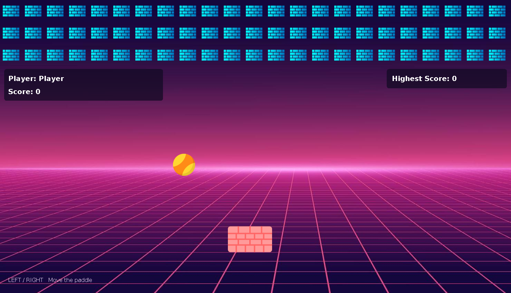

# Brick Breaker

A simple Java Swing game I made while learning Java and GUI programming. Move the paddle, bounce the ball, and break bricks to earn points.



## Play

Use the **left and right arrow keys** to move the paddle. Each broken brick earns 10 points. When the ball falls below the screen, you can return to the menu and play again. The best score is saved in `highScore.txt`.

## Open in Eclipse

1. Extract `BrickBreaker.zip`.
2. Select **File → Import → General → Existing Projects into Workspace**.
3. Select the extracted `BrickBreaker` folder and click **Finish**.
4. Use Java 17 or newer and run `src/brickBreakerGame/Main.java` as a Java application.

Keep `src/BricksBreak` in place: the original code loads images and sounds from that folder relative to the project directory.

## Run on Mac

With Java 17+ installed, open Terminal in the extracted project folder:

```sh
java -jar dist/BrickBreaker.jar
```

Or double-click `Start.command` if macOS allows it. To rebuild from source with a JDK:

```sh
sh build.sh
```

## Small presentation improvements

The original background, sprites, sounds, five classes, and existing comments are preserved. The menu buttons fit the window and keep their position on hover. The menu has a title and control hint. The game has readable score panels with matching fonts. The About page fits a compact window and wraps its text cleanly.

Small startup and replay safeguards handle a cancelled name prompt, missing audio devices, the first collision rectangle, and stopping the old timer when returning to the menu. Ball movement, paddle movement, brick layout, collisions, and score calculations remain the original implementation. `docs/changes.patch` shows every source change.

## Verification

The actual source builds with Java 17. A headless preview check used a temporary copy that replaced only the name dialog with a sample name. It checked asset loading, WAV decoding, original movement increments, panel rendering, and operation without an audio device. All original comment text and asset bytes were also checked for preservation.

Desktop menu interaction and audible playback need a local play-through. The original 1480 × 850 game area remains fixed, so use a display large enough for it. The original game has no separate victory screen; no new gameplay rules were added.

## GitHub

Upload `src`, `docs`, `README.md`, `build.sh`, `Start.command`, `.project`, `.classpath`, and `.gitignore`. Build output and local high scores are excluded. Build the game before using `Start.command` from a source-only clone.

The attached assets are included unchanged. Add their credits and applicable permissions before public redistribution. No license has been selected on your behalf.
