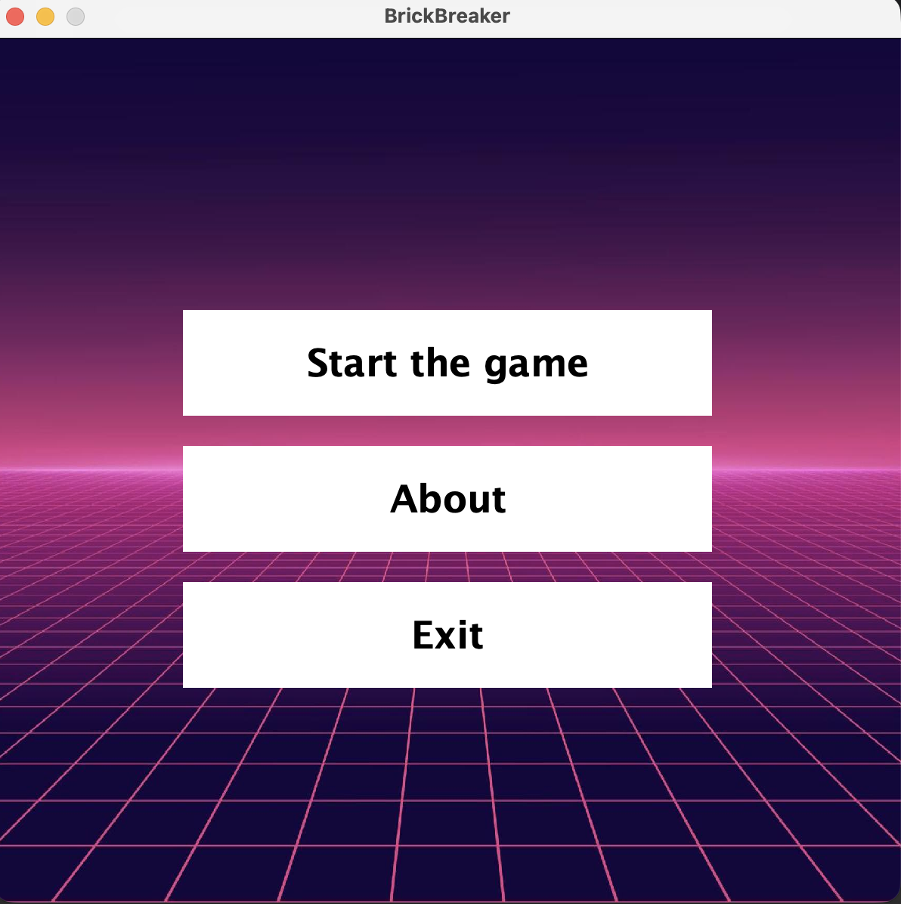
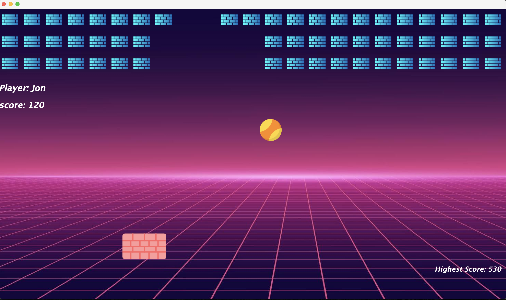
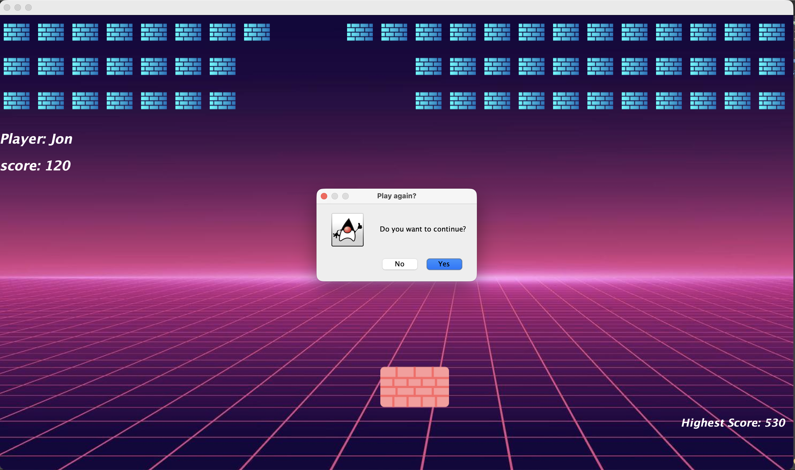
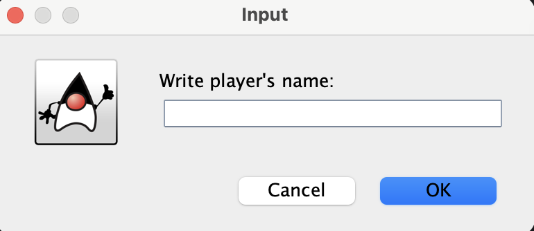

# BrickBreaker

A classic arcade-style Brick Breaker game developed in Java using Swing and AWT.

The objective is to control a paddle, keep the ball in play, and destroy bricks to earn points. The game features retro-inspired graphics, sound effects, and a persistent high-score system.

This project demonstrates object-oriented programming, GUI development, event handling, collision detection, and local file handling in Java.

## Features

- **Classic arcade gameplay:** Control a paddle to bounce the ball and break bricks.
- **Scoring system:** Earn 10 points for each destroyed brick.
- **High-score tracking:** Automatically save the highest score achieved across gaming sessions.
- **Ball physics:** Ball movement and direction change when colliding with walls, bricks, and the paddle.
- **Keyboard controls:** Move the paddle using the left and right arrow keys.
- **Main menu:** Start the game, view information, or exit.
- **Replay navigation:** Return to the main menu after Game Over.
- **Audio effects:** Background music and sound effects when bricks are destroyed.
- **Retro-inspired interface:** Custom background images and graphical elements.

## Screenshots

### Main Menu

*Screenshot coming soon.*

### Gameplay

*Screenshot coming soon.*

### Game Over


## Screenshots

### Main Menu


### Gameplay


### Gameplay Dialog


### Game Over



## Technologies Used

- **Java** — Game logic and object-oriented programming
- **Java Swing** — User interface and event handling
- **Java AWT** — Graphics rendering and collision detection
- **Java Sound API** — Background music and sound effects
- **Java I/O** — Local high-score persistence
- **Eclipse IDE** — Development environment

## Game Controls

| Key | Action |
|---|---|
| Left Arrow (←) | Move paddle left |
| Right Arrow (→) | Move paddle right |

## Getting Started

### Prerequisites

- Java Development Kit (JDK) compatible with the project's Java version
- Eclipse IDE or another Java development environment

### Installation

1. Clone the repository:

   ```bash
   git clone https://github.com/Abid-04/BreakBreaker_.git
   ```

2. Open Eclipse IDE.
3. Navigate to **File → Import → General → Existing Projects into Workspace**.
4. Select the cloned project directory.
5. Verify that the project uses a compatible JDK.
6. Locate the Java class containing the `main()` method and run it.

The game does not require an external database server.

## High Score Storage

BrickBreaker stores the highest score locally in the user's home directory:

```text
.brickbreaker/
└── highScore.txt
```

The game automatically creates the storage folder when saving a new record.

Only the highest score is retained, regardless of the player's name. The record remains available after restarting the application.

## Project Structure

The main classes include:

| Class | Responsibility |
|---|---|
| `Menu.java` | Main menu and navigation |
| `MyFrame.java` | Gameplay window |
| `MyPanel.java` | Game rendering, paddle movement, collision detection, and scoring |
| `gameInfo.java` | Game information screen |

## Future Improvements

Potential enhancements include:

- Multiple difficulty levels
- Pause and resume functionality
- Additional brick patterns
- Power-ups and special abilities
- Improved animations and responsive window sizing
- Standalone application packaging

## Author

Developed by **Abid**.

GitHub: [Abid-04](https://github.com/Abid-04)

## License

No license has been specified for this project.
